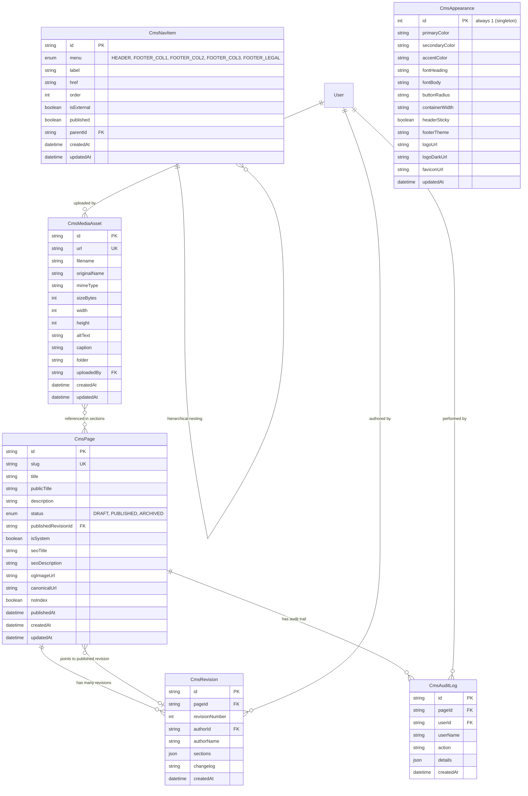
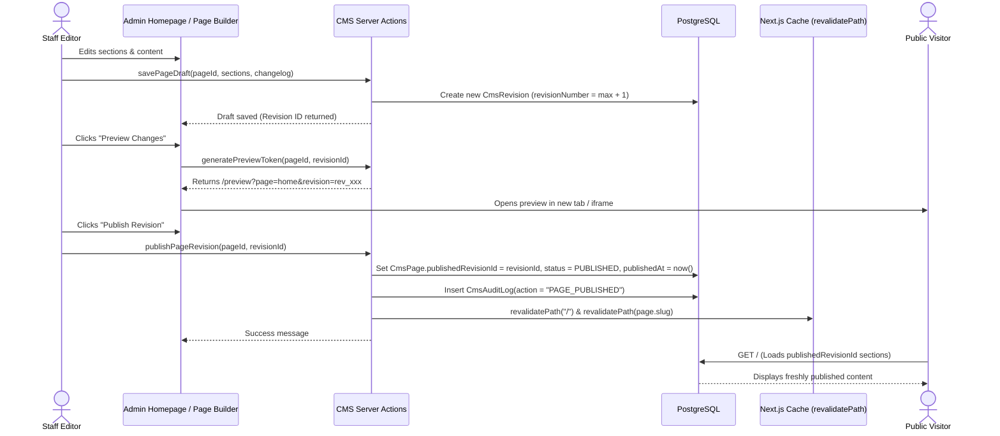

# LivingHope CMS Architecture & Technical Specification

**Version:** 2.0 (Phase 2 Modernization)  
**Date:** 2026-11-10  
**Authors:** LivingHope Core Architecture Team  
**Status:** Approved for Implementation

---

## 1. Executive Summary

LivingHope requires a cohesive, flexible, and robust Website Content Management System that allows authorized non-technical staff to control public-facing layouts, copy, hero banners, media, menus, and branding without writing code or redeploying the application.

This architecture achieves that goal while adhering to strict production standards:
- **No unsafe raw HTML injection or script execution.** All sections conform to typed, validated Zod schemas.
- **Transactional draft vs. published separation.** Public users only see published revisions. Drafts are safely isolated.
- **Fail-safe fallback:** Missing or empty CMS records seamlessly drop back to system-defined defaults.
- **Atomic revisions and audit trails:** Every modification creates a versioned revision with author attribution, diff logs, and single-click rollback.
- **Strict route collision protection:** Core operational paths (`/admin`, `/api`, `/account`, `/donate`) are permanently protected.

---

## 2. Database Model Architecture (Prisma & PostgreSQL)

The CMS relies on five interconnected models in `prisma/schema.prisma`:



---

## 3. Section Schema & Registry

Each section stored in `CmsRevision.sections` is an array of typed JSON objects:
```json
[
  {
    "id": "sec_hero_12345",
    "type": "hero",
    "enabled": true,
    "props": {
      "badge": "Every Child Deserves Hope",
      "title": "Restoring Dignity to Street-Connected Children in Ghana",
      "subtitle": "Join our mission to provide food, shelter, education, and vocational skills.",
      "imageUrl": "/images/hero-child.webp",
      "primaryCta": { "label": "Sponsor a Child", "href": "/sponsor-a-child" },
      "secondaryCta": { "label": "Make a Donation", "href": "/donate" }
    }
  }
]
```

### Supported Section Types:
1. `hero` — Hero banner with image, badges, CTA pair, and layout alignment.
2. `rich_text` — Controlled multi-column narrative, headings, lead paragraphs, and blockquotes.
3. `image_text` — Split side-by-side photo and narrative with bullet points.
4. `card_grid` — 2, 3, or 4 column feature grid with icons and links.
5. `impact_stats` — Visual KPI counter blocks (supports live database metrics or manual overrides).
6. `featured_children` — Children card showcase (automated urgent need or manual child picker).
7. `programmes` — Focus area cards with photos and outcome metrics.
8. `featured_stories` — Testimonial and impact story carousel with donor spotlight.
9. `testimonials` — Verified donor and beneficiary quotes with avatar images.
10. `faq` — Expandable accordion items with categorized questions.
11. `donation_cta` — High-impact giving banner with preset amount selector.
12. `partnership_cta` — Call to action specifically for churches, corporations, and brighteners.
13. `contact_info` — LivingHope operational office address, hours, phones, and Google Map embed.

---

## 4. Draft, Preview, and Publishing Workflow



---

## 5. Security and Guardrails

1. **System Reserved Slugs:**
   Attempting to create or edit a CMS page slug matching `admin`, `api`, `account`, `login`, `signup`, `forgot-password`, `reset-password`, `donate`, or `preview` is rejected with an explicit HTTP 400 validation error.
2. **Schema Validation:**
   Every section's `props` JSON is strictly parsed and sanitized using Zod schemas (`src/lib/cms-validations.ts`) before saving. No executable script tags or malicious `javascript:` URI schemes are permitted.
3. **Role-Based Access Control:**
   Only users with `ADMIN` or `SUPERADMIN` roles (verified via `requireStaff()`) can access CMS management endpoints or save revisions.
4. **Auditability:**
   Every creation, edit, publish, or rollback event is timestamped and recorded in `CmsAuditLog` with user ID, name, action name, and JSON diff metadata.

