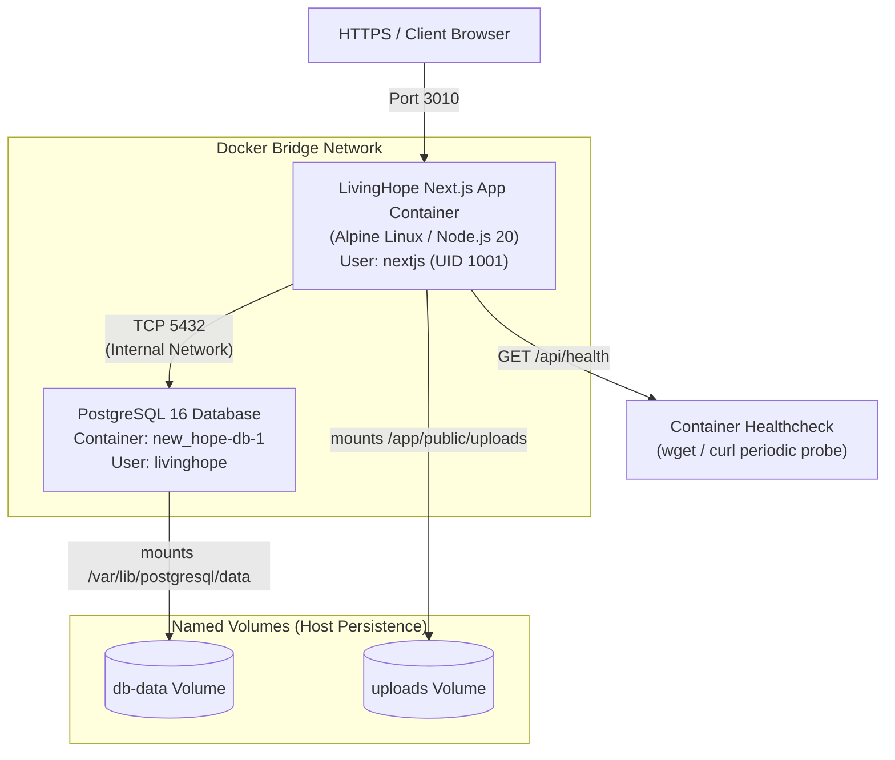

# LivingHope Platform — Docker Architecture & Infrastructure Design

## 1. High-Level Architecture & Topology

The LivingHope Platform container infrastructure is designed for high availability, security, persistence, and minimal resource overhead. The deployment is composed of two primary interconnected services orchestrated via Docker Compose:



---

## 2. Service Definitions

### 2.1 Web Application Service (`app`)
- **Base Image:** `node:20-alpine` (Minimal attack surface, lightweight footprint).
- **Execution User:** `nextjs` (UID: 1001, GID: 1001) — Non-root user to mitigate privilege escalation attacks.
- **Port Mapping:** Host `3010` $\rightarrow$ Container `3010`.
- **Init System:** `init: true` (Uses Tini inside the container to handle signal forwarding `SIGTERM`/`SIGINT` and zombie process reaping).
- **Entrypoint Command:** `sh -c "npx prisma migrate deploy && exec npm run start"`. Ensures database schema migrations are applied automatically before the Next.js production server starts serving requests.
- **Persistent Volume:** `uploads` mapped to `/app/public/uploads` for local media storage persistence across deployments.
- **Environment Variables:**
  - `DATABASE_URL`: `postgresql://livinghope:livinghope@db:5432/livinghope?schema=public`
  - `NODE_ENV`: `production`
  - `PORT`: `3010`
  - `STORAGE_DRIVER`: `local`

### 2.2 Database Service (`db`)
- **Base Image:** `postgres:16-alpine`.
- **Database Name:** `livinghope`.
- **Database User:** `livinghope`.
- **Port Mapping:** Host `5442` $\rightarrow$ Container `5432`.
- **Persistent Volume:** `db-data` mapped to `/var/lib/postgresql/data` ensures complete data durability across container restarts, rebuilds, and host reboots.
- **Healthcheck:** `pg_isready -U livinghope` (every 5 seconds, 10 retries).

---

## 3. Multi-Stage Dockerfile Design

The LivingHope `Dockerfile` uses a 4-stage build process to optimize caching, build speed, and final image size:

1. **Stage 1: Base (`node:20-alpine`)**
   - Sets working directory to `/app`.
   - Base Alpine configuration.

2. **Stage 2: Dependencies (`deps`)**
   - Installs `libc6-compat` (required for Prisma engines on Alpine/musl).
   - Copies `package.json`, `package-lock.json`, and Prisma schemas.
   - Runs `npm ci` with clean, reproducible dependency resolution.

3. **Stage 3: Builder (`builder`)**
   - Copies dependencies from `deps`.
   - Copies full application source code.
   - Executes `npx prisma generate` to generate the TypeScript client.
   - Executes `npm run build` using Next.js Turbopack compiler.

4. **Stage 4: Runner (`runner`)**
   - Installs lightweight runtime packages: `curl`, `wget`, `libc6-compat`.
   - Creates the system non-root user and group (`nodejs:nextjs`, UID 1001).
   - Creates `/app/public/uploads` with `chown -R nextjs:nodejs`.
   - Copies only the necessary build artifacts from `builder`:
     - `package.json`, `package-lock.json`
     - `.next` (Compiled production application)
     - `public` (Static assets and uploads)
     - `node_modules` (Production runtime packages)
     - `prisma` and `prisma.config.ts` (For automated runtime migrations)
   - Switches to `USER nextjs`.
   - Defines the container `HEALTHCHECK`.

---

## 4. Health Check Design (`/api/health`)

The application exposes a dedicated health check endpoint at `/api/health`:
- **Method:** `GET`
- **Checks Performed:**
  - **Database Connectivity:** Executes `SELECT 1` through Prisma. If PostgreSQL fails or is unreachable, returns HTTP 503 Service Unavailable.
  - **Latency:** Measures exact round-trip database query latency in milliseconds.
  - **Uptime:** Reports Node.js process uptime in seconds.
  - **Status Codes:**
    - `HTTP 200 OK`: Database connected, application healthy.
    - `HTTP 503 Service Unavailable`: Database disconnected or error thrown.
- **Docker Compose Health Probe:**
  ```yaml
  healthcheck:
    test: ["CMD-SHELL", "wget -qO- http://127.0.0.1:3010/api/health >/dev/null 2>&1 || exit 1"]
    interval: 10s
    timeout: 5s
    retries: 12
    start_period: 30s
  ```
- **CLI Healthcheck Utility:** `scripts/docker-healthcheck.sh` allows external monitoring agents or CI/CD pipelines to verify health with human-readable status codes and JSON payloads.

